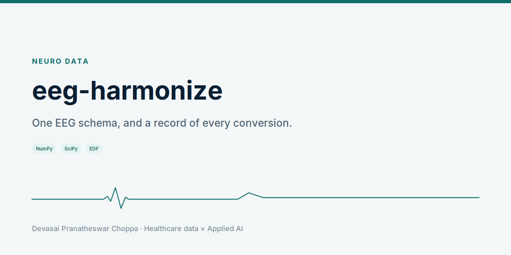
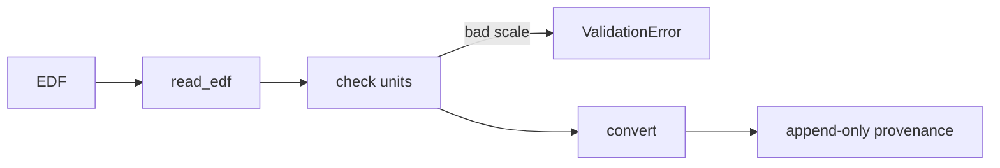

<picture>
  <source media="(prefers-color-scheme: dark)" srcset="docs/social-preview-dark.png">
  
</picture>

**A canonical EEG record and a conversion trail, so a channel rename does not look like a dataset effect.**

<p align="center">
  
</p>

Infrastructure, not a diagnostic. Sample clips are designed. TUH is not downloaded and is not redistributed here.

## Problem

Public EEG corpora disagree on channel names, units, and annotation timing. Those disagreements get mistaken for physiology.

## Solution

`eegh convert` reads a committed EDF clip into a canonical record, checks units, maps channels, and resamples with `resample_poly`. Every step is appended to a provenance chain. A bad unit scale raises.

## Architecture



Conversion lives in `src/eeg_harmonize/convert.py`. The canonical fields live in `src/eeg_harmonize/schema.py`.

## Tech stack

Python 3.11, Pydantic, NumPy, SciPy, Typer, Rich, DuckDB, pytest.

## Quickstart

```bash
make setup
eegh inspect data/sample/clean.edf
eegh convert --in data/sample/clean.edf
eegh convert --in data/sample/bad-units.edf
```

The bad-units command is expected to fail the unit check. `make demo` runs the full walkthrough. No credentials and no TUH download.

## Results

| Measurement | Result |
| --- | --- |
| Default resampler | `resample_poly` |
| Designed-clip convert | Succeeds on the clean clip |
| Bad unit scale | Rejected |
| Cross-dataset transfer on TUH | Not run |

## Roadmap

A real TUH, CHB-MIT, or Sleep-EDF adapter waits on a redistribution review. The repository does not claim those bytes are loaded.

## License

MIT.
